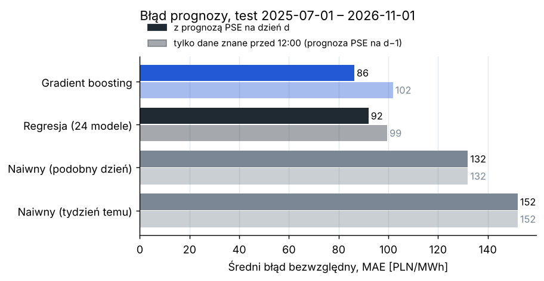
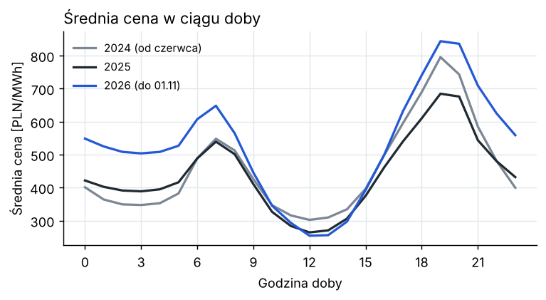
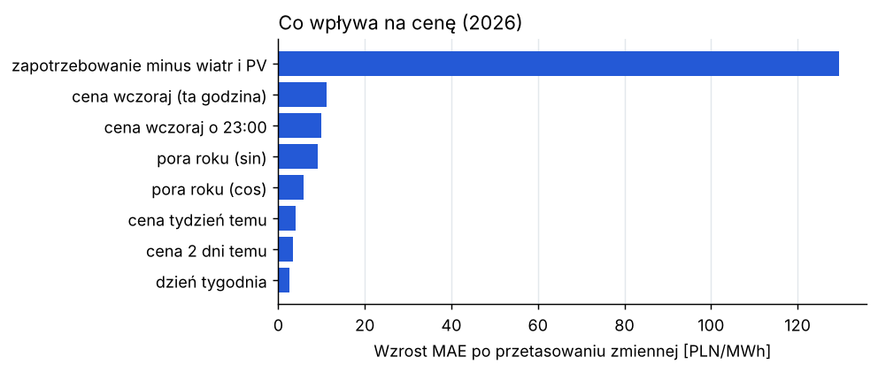
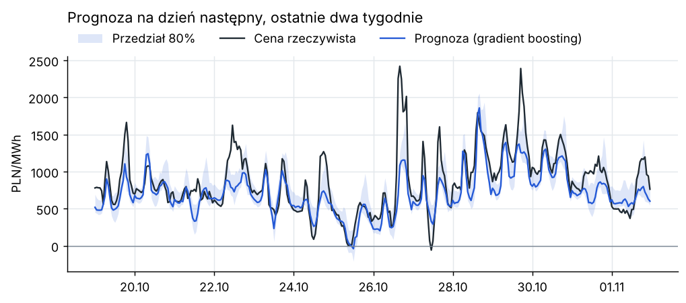
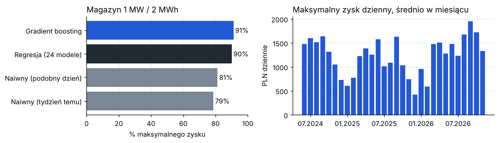

# Prognoza cen energii na rynku dnia następnego i wartość magazynu energii

Projekt prognozuje godzinowe ceny energii w Polsce na następny dzień i sprawdza, ile taka prognoza jest warta dla właściciela magazynu energii. Dane pobieram z API PSE (czerwiec 2024 – listopad 2026).

## Wyniki

Test na 489 dniach (1.07.2025 – 1.11.2026), średnia cena w tym okresie: 501 PLN/MWh.

| Model | Średni błąd (MAE) | Zmiana względem reguły „podobny dzień” | Zysk magazynu (% maksimum) |
|---|---|---|---|
| Cena sprzed tygodnia | 152 PLN/MWh | +15% | 79% |
| Reguła „podobny dzień” | 132 PLN/MWh | – | 81% |
| Regresja liniowa | 92 PLN/MWh | −30% | 90% |
| Gradient boosting | 86 PLN/MWh | −35% | 91% |

- Gradient boosting ma błąd o 35% mniejszy niż prosta reguła i jest statystycznie lepszy od regresji (test Diebolda-Mariano, p < 0,001).
- Najbardziej na cenę wpływa zapotrzebowanie pomniejszone o produkcję z wiatru i fotowoltaiki. Pozostałe zmienne mają dużo mniejsze znaczenie.
- Magazyn 1 MW / 2 MWh planowany według modelu zarabia średnio 123 PLN dziennie więcej niż planowany według prostej reguły. To około 45 tys. PLN rocznie na 1 MW.
- Liczba godzin z ujemną ceną rośnie: 146 w drugiej połowie 2024, 310 w 2025, 316 w 2026 (do 1 listopada).



Krótki raport z wynikami: [reports/Raport_prognoza_cen_energii.pdf](reports/Raport_prognoza_cen_energii.pdf).

## Dane

Dane pobiera skrypt `src/download_pse.py` z publicznego API PSE (`api.raporty.pse.pl`, bez klucza).

| Raport PSE | Co zawiera |
|---|---|
| `csdac-pln` | cena dla Polski z aukcji dnia następnego, PLN/MWh |
| `pdgopkd` | plan PSE na następną dobę: zapotrzebowanie, wiatr, fotowoltaika, MW |
| `his-wlk-cal` | rzeczywiste zapotrzebowanie, wiatr i fotowoltaika, MW |

API podaje wartości co 15 minut w czasie UTC. Uśredniam je do godzin i przeliczam na czas polski. W dni zmiany czasu usuwam powtórzoną godzinę albo uzupełniam brakującą, żeby każda doba miała 24 godziny.



## Jak to działa

Prognoza na dany dzień powstaje rano dzień wcześniej, przed zamknięciem aukcji o 12:00. Model korzysta z:
- cen z poprzednich dni (wczoraj, przedwczoraj, tydzień temu),
- planu PSE: prognozy zapotrzebowania, wiatru i fotowoltaiki,
- kalendarza: godzina, dzień tygodnia, święta, pora roku.

Plan PSE na następny dzień jest publikowany dzień wcześniej, ale nie wiem dokładnie o której. Dlatego liczę też wariant, w którym model zna tylko plan na dzień bieżący (na pewno dostępny przed 12:00). W tym wariancie błąd rośnie do około 100 PLN/MWh, a regresja i gradient boosting wypadają podobnie.

Porównuję cztery modele:
- dwie proste reguły jako punkt odniesienia: cena sprzed tygodnia oraz „podobny dzień” (w poniedziałek i weekend cena sprzed tygodnia, w pozostałe dni wczorajsza),
- regresję liniową, osobną dla każdej godziny (Ridge),
- gradient boosting (`HistGradientBoostingRegressor`), jeden model dla wszystkich godzin.

Test wygląda jak praca na żywo: model uczy się na danych sprzed okresu testowego, a co 28 dni uczy się od nowa z nowymi danymi. Żadna prognoza nie korzysta z danych z przyszłości.

Przedział 80% wyznaczam z błędów modelu z ostatnich 56 dni. Najpierw spróbowałem regresji kwantylowej, ale jej przedział był za wąski (obejmował 61% cen zamiast 80%). Przedział z ostatnich błędów obejmuje 74%.

Magazyn: dla każdego dnia liczę najlepszy plan ładowania i rozładowania (programowanie liniowe, `scipy.optimize.linprog`) na podstawie prognozy, a zysk rozliczam po rzeczywistych cenach. Założenia: sprawność 88%, koszt zużycia baterii 20 PLN/MWh, magazyn pusty na koniec dnia.

## Szczegóły wyników

Wpływ zmiennych: losowo mieszam jedną zmienną i sprawdzam, o ile rośnie błąd.



Ostatnie dwa tygodnie testu:



Kiedy model myli się najbardziej:
- wieczorem o 19:00–20:00 (błąd około 135 PLN/MWh, w nocy około 50), bo wtedy zdarzają się skoki cen powyżej 2000 PLN/MWh,
- przy nagłej zmianie poziomu cen: w październiku 2026 średnia cena wzrosła do 740 PLN/MWh, a model zaniżał ją średnio o 117 PLN/MWh.

Magazyn: po lewej część maksymalnego zysku dla każdego modelu, po prawej maksymalny możliwy zysk w kolejnych miesiącach (najwyższy wiosną i latem).



## Ograniczenia

- Nie wiem dokładnie, o której PSE publikuje plan na następny dzień. W praktyce lepiej byłoby użyć porannego planu 5-dniowego (PK5L) albo własnej prognozy pogody.
- Model nie zna cen paliw, uprawnień CO2 ani wymiany z sąsiednimi krajami.
- Wycena magazynu pomija rynek bilansujący i usługi dla PSE oraz zakłada, że magazyn nie wpływa na ceny.

## Uruchomienie

```bash
pip install -r requirements.txt
python3 src/download_pse.py   # pobranie danych, kilka minut
python3 src/run.py            # model, wyniki i wykresy w reports/
python3 -m pytest             # testy
```

Jeśli na macOS pobieranie kończy się błędem `CERTIFICATE_VERIFY_FAILED`, pomaga użycie certyfikatów systemowych:

```bash
security find-certificate -a -p /System/Library/Keychains/SystemRootCertificates.keychain \
  /Library/Keychains/System.keychain ~/Library/Keychains/login.keychain-db > ~/macos-certs.pem
SSL_CERT_FILE=~/macos-certs.pem python3 src/download_pse.py
```

Pliki:
- `src/download_pse.py` – pobieranie danych z API PSE
- `src/data.py` – wczytanie danych
- `src/forecast.py` – zmienne, modele, test
- `src/battery.py` – plan pracy magazynu
- `src/run.py` – uruchamia wszystko i rysuje wykresy
- `reports/summary.json` – wszystkie wyniki liczbowe
